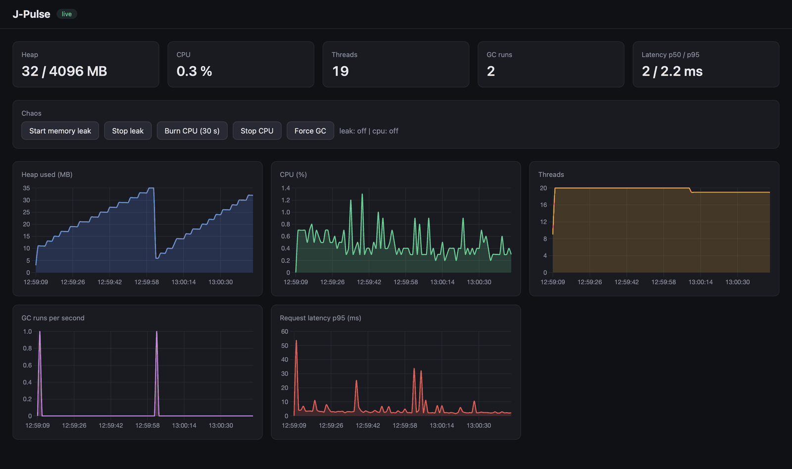
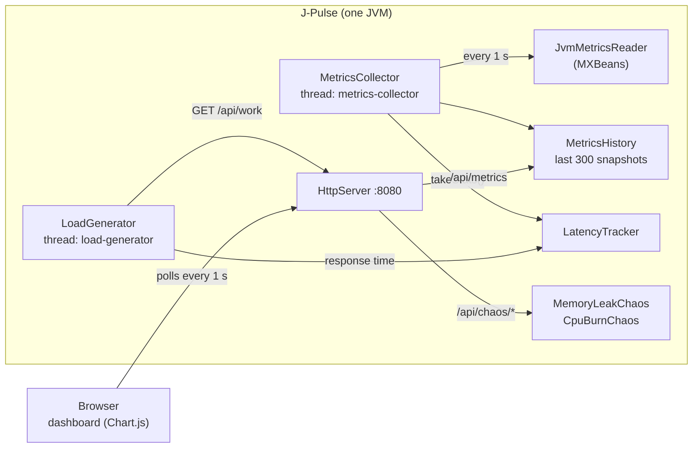

# J-Pulse

A lightweight JVM monitor with a built-in chaos-engineering panel, written in plain Java with no frameworks.

J-Pulse shows what happens inside a running JVM when something goes wrong. It collects heap, CPU, thread, garbage-collection and request-latency metrics every second, and it can deliberately break the application (memory leak, CPU load) so you can watch how each failure looks on the dashboard.



*Memory leak and CPU burn running at the same time: heap climbs to the 85% safety cap, CPU holds at ~50%, and extra worker threads appear.*

## Why I built it

I wanted to understand Java beyond the syntax: how the heap fills up, when the garbage collector runs, and how threads share data. The most direct way to see that was to build a tool that measures it and then break the JVM on purpose.

## Features

- **Live JVM metrics, every second:** heap usage, process CPU load, live threads, GC runs, request latency (p50 / p95)
- **5-minute history** kept in memory and rendered as live charts
- **Chaos scenarios** you can trigger from the browser:
  - **Memory leak:** holds on to 5 MB blocks until the heap reaches 85%, then stops growing so the JVM never crashes
  - **CPU burn:** loads half of the CPU cores and switches itself off after 30 seconds
  - **Force GC:** asks the JVM to run a full garbage collection
- **Synthetic latency monitoring:** a background client calls a test endpoint 10 times per second and measures the response time
- **No frameworks:** JDK HTTP server, JMX MXBeans and a small HTML/JS front end with Chart.js

## Quick start

**Requirements:** Java 21+, Maven, and an internet connection (Chart.js is loaded from a CDN).

```bash
git clone https://github.com/Petrov-Yehor/jvm-pulse-monitor.git
cd jvm-pulse-monitor
mvn compile
java -Xmx256m -cp target/classes dev.egor.jpulse.App
```

Then open **http://localhost:8080**.

`-Xmx256m` limits the heap to 256 MB so the memory leak reaches its cap within a few seconds. In IntelliJ, run `App.main` and add `-Xmx256m` under *Run → Edit Configurations → VM options*.

## Try it

| Action | What you should see |
|---|---|
| **Start memory leak** | Heap grows in a straight line and flattens at ~85%. One extra thread appears. |
| **Stop leak** | Heap stays high: the objects are now garbage, but the GC has not run yet. |
| **Force GC** | Heap drops back to a few MB and the GC counter increases. |
| **Burn CPU (30 s)** | CPU rises to ~50% (half the cores at 100%) and switches off automatically after 30 s. |

The second row is the interesting one. A high heap is not a leak by itself. A leak is a heap that **stays high after garbage collection**.

## How it works



### Where the metrics come from

| Metric | Source |
|---|---|
| Heap used / max | `MemoryMXBean.getHeapMemoryUsage()` |
| Process CPU | `com.sun.management.OperatingSystemMXBean.getProcessCpuLoad()` |
| Live threads | `ThreadMXBean.getThreadCount()` |
| GC runs | sum of `getCollectionCount()` over all `GarbageCollectorMXBean`s (G1 registers several) |
| Latency p50 / p95 | measured by `LoadGenerator` with `System.nanoTime()`, percentiles computed per second |

### Threads

| Thread | Job |
|---|---|
| `metrics-collector` | reads a snapshot every second and stores it in the history |
| `load-generator` | sends a request to `/api/work` every 100 ms and records how long it took |
| `chaos-memory-leak` | runs only while the leak is active |
| `chaos-cpu-burn-N` | one per loaded core, only while CPU burn is active |

The background threads are daemon threads, so they never keep the JVM alive on their own.

## API

| Method | Path | Description |
|---|---|---|
| GET | `/` | dashboard (static files from `resources/public`) |
| GET | `/api/health` | `{"status":"UP","uptimeMs":...}` |
| GET | `/api/metrics` | metric history as a JSON array |
| GET | `/api/work` | small CPU task used as the latency target |
| GET | `/api/chaos/status` | `{"leak":false,"cpu":false}` |
| POST | `/api/chaos/leak/start` · `/leak/stop` | start / stop the memory leak |
| POST | `/api/chaos/cpu/start` · `/cpu/stop` | start / stop the CPU burn |
| POST | `/api/chaos/gc` | request a garbage collection |

State-changing actions use POST; reading uses GET.

## Design decisions

- **Plain Java, no frameworks.** Every request handler is a small class implementing `HttpHandler`, so it is clear what happens on each request.
- **Thread safety.** `MetricsHistory` and `LatencyTracker` are shared between threads, so their methods are `synchronized`. `getAll()` returns a copy, so readers never iterate over a list that another thread is changing. The chaos on/off flags are `volatile`.
- **Bounded history.** A `LinkedList` capped at 300 entries: new snapshots are added at the end, the oldest one is removed from the front, both in O(1).
- **Percentiles instead of averages.** An average hides slow requests; p95 shows what the slowest 5% of requests experience.
- **Safe chaos.** The memory leak stops at 85% of the max heap to avoid `OutOfMemoryError`, and the CPU burn has a hard 30-second limit.
- **Counter vs. gauge.** `gcCount` only ever grows, so the dashboard plots the difference per second instead of the raw value.

## Project structure

```
src/main/java/dev/egor/jpulse/
├── App.java                  wiring: creates the components and starts the server
├── api/                      HTTP handlers (static files, metrics, chaos, health, work)
├── metrics/                  snapshot, JVM reader, collector thread, history
├── chaos/                    memory leak and CPU burn scenarios
└── latency/                  load generator, latency tracker, percentile stats
src/main/resources/public/    dashboard: index.html, style.css, app.js
```

## Roadmap

- Threshold alerts (WARNING / CRITICAL) with hysteresis
- Monitoring a separate JVM through remote JMX

## Built with AI assistance

I used AI tools (Claude, Gemini) as a tutor while building this project: to explain JVM concepts, review my code and help me find bugs. I went through every class myself and can explain how each part works.
